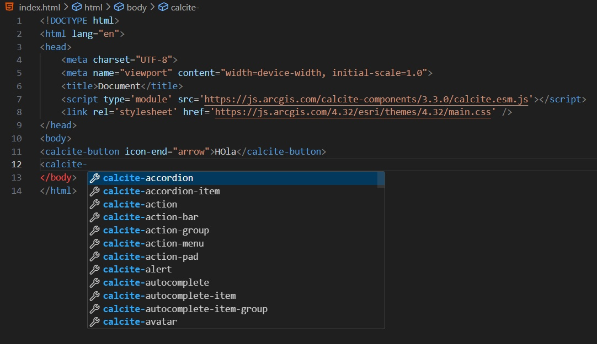
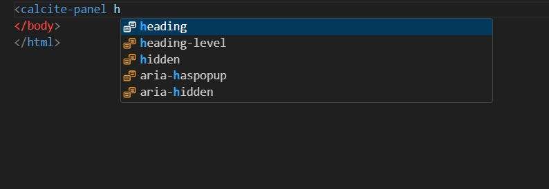
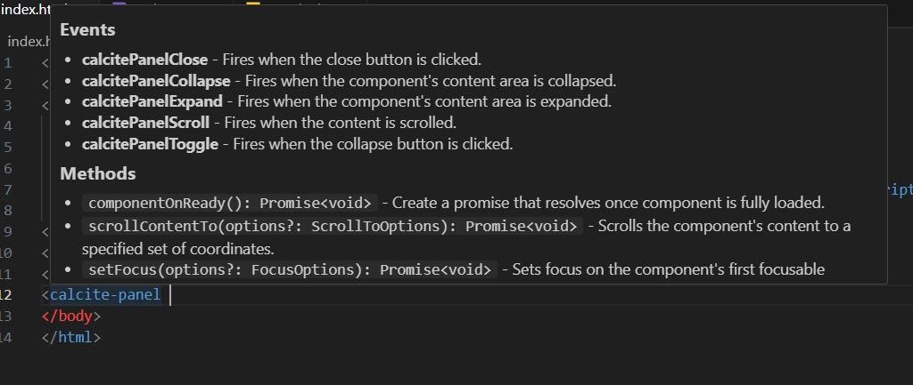
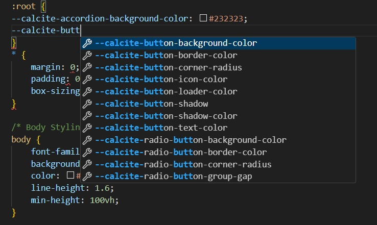

# Calcite IntelliSense for HTML and CSS variables.

Injects HTML IntelliSense (completion, hover, documentation) for **Esri Calcite Design System** web components and CSS variables IntelliSense, using Esri’s official custom-data JSON.

## Features

*   Tag and attribute completion for Calcite components
*   Hover documentation (descriptions, attribute value hints)
*   Works in HTML and common web contexts (`.html`, `.ts/.tsx`, `.js/.jsx`, including template strings)
*   CSS Calcite variables completion

## Requirements

*   **VS Code** ≥ 1.93

## Usage

### HTML

Start typing any Calcite component tag (e.g., `<calcite-accordion ...>`) or an attribute (e.g., `scale="m"`) and IntelliSense will suggest options derived from the custom-data JSON.

_Usage Example Panel_  

_Usage Example Panel attribute_   

_Usage Panel Documentation_  

### CSS

_Usage Example Calcite Button VCSS Variable_  

Official components documentation: [Components | Calcite Design System | Esri Developer](https://developers.arcgis.com/calcite-design-system/components/)

---

## Supported Components

### HTML

Extended Calcite Design System components [documentation](components.md).

Total: 113

*   calcite-accordion
*   calcite-accordion-item
*   calcite-action
*   calcite-action-bar
*   calcite-action-group
*   calcite-action-menu
*   calcite-action-pad
*   calcite-alert
*   calcite-autocomplete
*   calcite-autocomplete-item
*   calcite-autocomplete-item-group
*   calcite-avatar
*   calcite-block
*   calcite-block-group
*   calcite-block-section
*   calcite-button
*   calcite-card
*   calcite-card-group
*   calcite-carousel
*   calcite-carousel-item
*   calcite-checkbox
*   calcite-chip
*   calcite-chip-group
*   calcite-color-picker
*   calcite-color-picker-hex-input
*   calcite-color-picker-swatch
*   calcite-combobox
*   calcite-combobox-item
*   calcite-combobox-item-group
*   calcite-date-picker
*   calcite-date-picker-day
*   calcite-date-picker-month
*   calcite-date-picker-month-header
*   calcite-dialog
*   calcite-dropdown
*   calcite-dropdown-group
*   calcite-dropdown-item
*   calcite-fab
*   calcite-filter
*   calcite-flow
*   calcite-flow-item
*   calcite-graph
*   calcite-handle
*   calcite-icon
*   calcite-inline-editable
*   calcite-input
*   calcite-input-date-picker
*   calcite-input-message
*   calcite-input-number
*   calcite-input-text
*   calcite-input-time-picker
*   calcite-input-time-zone
*   calcite-label
*   calcite-link
*   calcite-list
*   calcite-list-item
*   calcite-list-item-group
*   calcite-loader
*   calcite-menu
*   calcite-menu-item
*   calcite-meter
*   calcite-modal
*   calcite-navigation
*   calcite-navigation-logo
*   calcite-navigation-user
*   calcite-notice
*   calcite-option
*   calcite-option-group
*   calcite-pagination
*   calcite-panel
*   calcite-popover
*   calcite-progress
*   calcite-radio-button
*   calcite-radio-button-group
*   calcite-rating
*   calcite-scrim
*   calcite-segmented-control
*   calcite-segmented-control-item
*   calcite-select
*   calcite-sheet
*   calcite-shell
*   calcite-shell-center-row
*   calcite-shell-panel
*   calcite-slider
*   calcite-sort-handle
*   calcite-sortable-list
*   calcite-split-button
*   calcite-stack
*   calcite-stepper
*   calcite-stepper-item
*   calcite-swatch
*   calcite-swatch-group
*   calcite-switch
*   calcite-tab
*   calcite-tab-nav
*   calcite-tab-title
*   calcite-table
*   calcite-table-cell
*   calcite-table-header
*   calcite-table-row
*   calcite-tabs
*   calcite-text-area
*   calcite-tile
*   calcite-tile-group
*   calcite-tile-select
*   calcite-tile-select-group
*   calcite-time-picker
*   calcite-tip
*   calcite-tip-group
*   calcite-tip-manager
*   calcite-tooltip
*   calcite-tree
*   calcite-tree-item

### CSS variables

Total: 762 Variables

| variable | description |
| --- | --- |
| \--calcite-accordion-border-color | Specifies the component's border color. |
| \--calcite-accordion-background-color | Specifies the component's background color. |
| \--calcite-accordion-text-color | Specifies the component's text color. |
| \--calcite-accordion-text-color-hover | Specifies the component's main text color on hover. |
| \--calcite-accordion-text-color-press | Specifies the component's main text color when pressed. |
| \--calcite-accordion-border-color | Specifies the component's border color. |
| \--calcite-accordion-background-color | Specifies the component's background color. |
| \--calcite-accordion-text-color | Specifies the component's text color. |
| \--calcite-accordion-text-color-hover | Specifies the component's main text color on hover. |
| \--calcite-accordion-text-color-press | Specifies the component's main text color when pressed. |
| \--calcite-accordion-item-background-color | \[Deprecated\] Use \`--calcite-accordion-background-color\`. Specifies the component's background color. |
| \--calcite-accordion-item-border-color | \[Deprecated\] Use \`--calcite-accordion-border-color\`. Specifies the component's border color. |
| \--calcite-accordion-item-content-space | Specifies the component's padding. |
| \--calcite-accordion-item-end-icon-color | Specifies the component's \`iconEnd\` color. Falls back to \`--calcite-accordion-item-icon-color\` or current color. |
| \--calcite-accordion-item-expand-icon-color | Specifies the component's expand icon color. |
| \--calcite-accordion-item-header-background-color | Specifies the component's \`heading\` background color. |
| \--calcite-accordion-item-header-background-color-hover | Specifies the component's \`heading\` background color when hovered. |
| \--calcite-accordion-item-header-background-color-press | Specifies the component's \`heading\` background color when pressed. |
| \--calcite-accordion-item-heading-text-color | Specifies the component's \`heading\` text color. |
| \--calcite-accordion-item-icon-color | \[Deprecated\] Use \`--calcite-icon-color\`. Specifies the component's default icon color. |
| \--calcite-accordion-item-start-icon-color | Specifies the component's \`iconStart\` color. Falls back to \`--calcite-accordion-item-icon-color\` or current color. |
| \--calcite-accordion-item-text-color | \[Deprecated\] Use \`--calcite-accordion-text-color\`. Specifies the component's text color. |
| \--calcite-accordion-item-text-color-hover | \[Deprecated\] Use \`--calcite-accordion-text-color-hover\`. Specifies the component's text color on hover. |
| \--calcite-accordion-item-text-color-press | \[Deprecated\] Use \`--calcite-accordion-text-color-press\`. Specifies the component's text color on press. |
| \--calcite-action-background-color-hover | Specifies the component's background color when hovered or focused. |
| \--calcite-action-background-color-press | Specifies the component's background color when active. |
| \--calcite-action-background-color-pressed | \[Deprecated\] Use --calcite-action-background-color-press. Specifies the component's background color when active. |
| \--calcite-action-background-color | Specifies the component's background color. |
| \--calcite-action-corner-radius-end-end | \[Deprecated\] Use --calcite-action-corner-radius. Specifies the component's corner radius end end. |
| \--calcite-action-corner-radius-end-start | \[Deprecated\] Use --calcite-action-corner-radius. Specifies the component's corner radius end start. |
| \--calcite-action-corner-radius-start-end | \[Deprecated\] Use --calcite-action-corner-radius. Specifies the component's corner radius start end. |
| \--calcite-action-corner-radius-start-start | \[Deprecated\] Use --calcite-action-corner-radius. Specifies the component's corner radius start start. |
| \--calcite-action-corner-radius | Specifies the component's corner radius. |
| \--calcite-action-indicator-color | Specifies the component's indicator color. |
| \--calcite-action-text-color-press | Specifies the component's text color when pressed or hovered. |
| \--calcite-action-text-color-pressed | \[Deprecated\] Use --calcite-action-text-color-press. Specifies the component's text color when hovered. |
| \--calcite-action-text-color | Specifies the component's text color. |
| \--calcite-action-bar-background-color | Specifies the component's background color. |
| \--calcite-action-bar-corner-radius | Specifies the component's border radius when \`floating\` is \`true\`. |
| \--calcite-action-bar-expanded-max-width | When \`layout\` is \`"vertical"\`, specifies the component's maximum width. |
| \--calcite-action-bar-items-space | Specifies the space between slotted components in the component. |
| \--calcite-action-bar-shadow | Specifies the component's shadow when \`floating\` is \`true\`. |
| \--calcite-action-background-color | Specifies the component's background color. |
| \--calcite-action-group-border-color | Specifies the component's border color when used in a \`calcite-action-bar\` or \`calcite-action-menu\`. |
| \--calcite-action-group-columns | When \`layout\` is \`"grid"\`, specifies the component's grid-template-columns. |
| \--calcite-action-group-gap | When \`layout\` is \`"grid"\`, specifies the component's gap. |
| \--calcite-action-group-padding | \[Deprecated\] Use \`--calcite-action-group-gap\`. Specifies the component's padding. |
| \--calcite-action-menu-items-space | Specifies the space between actions in the menu. |
| \--calcite-action-pad-corner-radius | Specifies the component's border radius. |
| \--calcite-action-pad-expanded-max-width | When \`layout\` is \`"vertical"\`, specifies the component's maximum width when \`expanded\`. |
| \--calcite-action-pad-items-space | Specifies the component's space between slotted components. |
| \--calcite-alert-width | Specifies the width of the component. |
| \--calcite-alert-background-color | Specifies the component's background color. |
| \--calcite-alert-corner-radius | Specifies the component's corner radius. |
| \--calcite-alert-shadow | Specifies the component's shadow. |
| \--calcite-alert-offset-size | Specifies the component's \`placement\` offset. |
| \--calcite-autocomplete-background-color | Specifies the background color of the component. |
| \--calcite-autocomplete-corner-radius | Specifies the component's corner radius. |
| \--calcite-autocomplete-text-color | Specifies the text color of the component. |
| \--calcite-autocomplete-input-prefix-size | Specifies the Input's prefix width, when present. |
| \--calcite-autocomplete-input-suffix-size | Specifies the Input's suffix width, when present. |
| \--calcite-autocomplete-input-background-color | Specifies the background color of the Input. |
| \--calcite-autocomplete-input-border-color | Specifies the border color of the Input. |
| \--calcite-autocomplete-input-corner-radius | Specifies the corner radius of the Input. |
| \--calcite-autocomplete-input-shadow | Specifies the shadow of the Input. |
| \--calcite-autocomplete-input-icon-color | Specifies the icon color of the Input. |
| \--calcite-autocomplete-input-text-color | Specifies the text color of the Input. |
| \--calcite-autocomplete-input-placeholder-text-color | Specifies the color of placeholder text in the Input. |
| \--calcite-autocomplete-input-actions-background-color | Specifies the background color of Input's \`clearable\` element. |
| \--calcite-autocomplete-input-actions-background-color-hover | Specifies the background color of Input's \`clearable\` element when hovered. |
| \--calcite-autocomplete-input-actions-background-color-press | Specifies the background color of Input's \`clearable\` element when pressed. |
| \--calcite-autocomplete-input-actions-icon-color | Specifies the icon color of Input's \`clearable\` element. |
| \--calcite-autocomplete-input-actions-icon-color-hover | Specifies the icon color of Input's \`clearable\` element when hovered. |
| \--calcite-autocomplete-input-actions-icon-color-press | Specifies the icon color of Input's \`clearable\` element when pressed. |
| \--calcite-autocomplete-input-loading-background-color | Specifies the background color of the Input's \`loading\` element, when present. |
| \--calcite-autocomplete-input-loading-fill-color | Specifies the fill color of the Input's \`loading\` element, when present. |
| \--calcite-autocomplete-input-prefix-background-color | Specifies the background color of the Input's prefix, when present. |
| \--calcite-autocomplete-input-prefix-text-color | Specifies the text color of the Input's prefix, when present. |
| \--calcite-autocomplete-input-suffix-background-color | Specifies the background color of the Input's suffix, when present. |
| \--calcite-autocomplete-input-suffix-text-color | Specifies the text color of the Input's suffix, when present. |
| \--calcite-autocomplete-background-color | Specifies the background color of the component. |
| \--calcite-autocomplete-description-text-color | Specifies the text color of the component's description. |
| \--calcite-autocomplete-heading-text-color | Specifies the text color of the component's heading. |
| \--calcite-autocomplete-text-color | Specifies the text color of the component. |
| \--calcite-autocomplete-background-color | Specifies the background color of the component. |
| \--calcite-autocomplete-border-color | Specifies the border color of the component. |
| \--calcite-autocomplete-text-color | Specifies the text color of the component. |
| \--calcite-avatar-corner-radius | Specifies the component's corner radius. |
| \--calcite-avatar-color | Specifies the component's icon or initial color. |
| \--calcite-avatar-background-color | Specifies the component's background color. |
| \--calcite-block-border-color | Specifies the component's border color. |
| \--calcite-block-content-space | Specifies the space of the component's \`default\` slot. |
| \--calcite-block-header-background-color | Specifies the component's \`heading\` background color. |
| \--calcite-block-header-background-color-hover | Specifies the component's \`heading\` background color when hovered. |
| \--calcite-block-header-background-color-press | Specifies the component's \`heading\` background color when pressed. |
| \--calcite-block-heading-text-color | Specifies the component's \`heading\` text color. |
| \--calcite-block-heading-text-color-press | \[Deprecated\] use \`--calcite-block-heading-text-color\` instead - When the component is \`expanded\`, specifies the \`heading\` text color. |
| \--calcite-block-padding | \[Deprecated\] use \`--calcite-block-content-space\` instead - Specifies the padding of the component's \`default\` slot. |
| \--calcite-block-text-color | \[Deprecated\] Specifies the component's text color. |
| \--calcite-block-description-text-color | Specifies the component's \`description\` text color. |
| \--calcite-block-icon-color | Specifies the component's \`collapsible\` icon, \`iconStart\` and \`iconEnd\` color. |
| \--calcite-block-icon-color-hover | Specifies the component's \`collapsible\` icon color when hovered. |
| \--calcite-block-section-background-color | Specifies the component's background color. |
| \--calcite-block-section-border-color | Specifies the component's border color. When \`expanded\`, applies to the component's bottom border. |
| \--calcite-block-section-header-text-color | Specifies the component's header text color. |
| \--calcite-block-section-text-color | Specifies the component's text color. |
| \--calcite-block-section-text-color-hover | Specifies the component's text color on hover. |
| \--calcite-block-section-content-space | Specifies the padding of the component's content in \`default\` slot. |
| \--calcite-button-background-color | Specifies the component's background color. |
| \--calcite-button-border-color | Specifies the component's border color. |
| \--calcite-button-corner-radius | Specifies the component's corner radius. |
| \--calcite-button-icon-color | Specifies the component's \`iconStart\` and |
| \--calcite-button-loader-color | Specifies the component's loader color. |
| \--calcite-button-shadow-color | \[Deprecated\] Use \`--calcite-button-shadow\`. Specifies the component's box-shadow color. |
| \--calcite-button-text-color | Specifies the component's text color. |
| \--calcite-button-shadow | Specifies the component's shadow. |
| \--calcite-card-accent-color-selected | Specifies the component's accent color when \`selected\`. |
| \--calcite-card-background-color | Specifies the component's background color. |
| \--calcite-card-border-color | Specifies the component's border color. |
| \--calcite-card-corner-radius | Specifies the component's corner radius. |
| \--calcite-card-selection-background-color-active | \[Deprecated\] Use \`--calcite-card-selection-background-color-press\`. Specifies the component's selection element background color when active. |
| \--calcite-card-selection-background-color-hover | Specifies the component's selection element background color when hovered. |
| \--calcite-card-selection-background-color-press | Specifies the component's selection element background color when active. |
| \--calcite-card-selection-background-color-selected | \[Deprecated\] Use \`--calcite-card-background-color\`. Specifies the component's selection element icon color when \`selected\`. |
| \--calcite-card-selection-background-color | \[Deprecated\] Use \`--calcite-card-background-color\`. Specifies the component's selection element background color. |
| \--calcite-card-selection-color-hover | Specifies the component's selection element color when hovered or focused. |
| \--calcite-card-selection-color | Specifies the component's selection element color. |
| \--calcite-card-selection-icon-color-hover | \[Deprecated\] Use \`--calcite-card-selection-color-hover\`. Specifies the component's selection element icon color when hovered. |
| \--calcite-card-selection-icon-color-selected | \[Deprecated\] Use \`--calcite-card-accent-color-selected\`. Specifies the component's selection element icon color when \`selected\`. |
| \--calcite-card-selection-icon-color | \[Deprecated\] Use \`--calcite-card-selection-color\`. Specifies the component's selection element icon color. |
| \--calcite-card-shadow | Specifies the component's shadow. |
| \--calcite-card-group-gap | \[Deprecated\] Use \`--calcite-card-group-space\`. Specifies the gap between slotted elements. |
| \--calcite-card-group-space | Specifies the space between slotted elements. |
| \--calcite-checkbox-size | Specifies the component's height and width. |
| \--calcite-checkbox-border-color | Specifies the component's color. |
| \--calcite-checkbox-border-color-hover | Specifies the component's color when hovered. |
| \--calcite-checkbox-border-color-press | Specifies the component's color when pressed. |
| \--calcite-checkbox-icon-color | Specifies the component's icon color. |
| \--calcite-chip-background-color | Specifies the component's background color. |
| \--calcite-chip-border-color | Specifies the component's border color. |
| \--calcite-chip-close-icon-color | Specifies the component's close element icon color. |
| \--calcite-chip-corner-radius | Specifies the component's corner radius. |
| \--calcite-chip-icon-color | Specifies the component's icon color. |
| \--calcite-chip-select-icon-color-press | Specifies the component's selection element icon color when active. |
| \--calcite-chip-select-icon-color-pressed | \[Deprecated\] Use \`--calcite-chip-select-icon-color-press\`. Specifies the component's selection element icon color when active. |
| \--calcite-chip-select-icon-color | Specifies the component's selection element icon color. |
| \--calcite-chip-text-color | Specifies the component's text color. |
| \--calcite-color-picker-background-color | Specifies the component's background color. |
| \--calcite-color-picker-border-color | Specifies the component's border color. |
| \--calcite-color-picker-corner-radius | Specifies the component's corner radius. |
| \--calcite-color-picker-shadow | Specifies the component's shadow. |
| \--calcite-color-picker-text-color | Specifies the component's text color. |
| \--calcite-color-picker-input-background-color | Specifies the component's input background color. |
| \--calcite-color-picker-input-border-color | Specifies the component's input border color. |
| \--calcite-color-picker-input-text-color | Specifies the component's input text color. |
| \--calcite-color-picker-input-prefix-background-color | When \`hexDisabled\` is not \`true\`, specifies the component's input prefix background color. |
| \--calcite-color-picker-input-prefix-text-color | When \`hexDisabled\` is not \`true\`, specifies the component's input prefix text color. |
| \--calcite-color-picker-input-suffix-background-color | When \`alphaChannel\` is \`true\`, specifies the component's input suffix background color. |
| \--calcite-color-picker-input-suffix-text-color | When \`alphaChannel\` is \`true\`, specifies the component's input suffix text color. |
| \--calcite-color-picker-tab-border-color | Specifies the component's tab border color. |
| \--calcite-color-picker-tab-text-color | Specifies the component's tab text color. |
| \--calcite-color-picker-tab-accent-color-press | Specifies the component's tab accent color when selected or active. |
| \--calcite-color-picker-swatch-corner-radius | Specifies the component's swatch corner radius. |
| \--calcite-color-picker-action-text-color-press | Specifies the component's \`savedColors\` action text color when pressed. |
| \--calcite-color-picker-action-text-color-hover | Specifies the component's \`savedColors\` action text color when hovered. |
| \--calcite-color-picker-action-text-color | Specifies the component's \`savedColors\` action text color. |
| \--calcite-combobox-divider-color | Specifies the component's divider color. |
| \--calcite-combobox-icon-color | Specifies the component's icon color. |
| \--calcite-combobox-icon-color-hover | Specifies the component's icon color when hovered. |
| \--calcite-combobox-background-color | Specifies the background color of the component's listbox. |
| \--calcite-combobox-input-border-color | Specifies the border color of the component's input. |
| \--calcite-combobox-input-background-color | Specifies the background color of the component's input. |
| \--calcite-combobox-input-height | Specifies the height of the component's input. |
| \--calcite-combobox-input-text-color | When \`selectionDisplay\` is \`"single"\`, specifies the text color of the component's input. |
| \--calcite-combobox-item-border-color | \[Deprecated\] Specifies the component's border color. |
| \--calcite-combobox-text-color | Specifies the component's text and \`icon\` color. |
| \--calcite-combobox-text-color-hover | Specifies the component's text and \`icon\` color when hovered. |
| \--calcite-combobox-item-background-color-active | Specifies the component's background color when active. |
| \--calcite-combobox-item-background-color-hover | Specifies the component's background color when hovered. |
| \--calcite-combobox-item-shadow | Specifies the component's shadow. |
| \--calcite-combobox-selected-icon-color | Specifies the component's selected indicator icon color. |
| \--calcite-combobox-description-text-color | Specifies the component's \`description\` and \`shortHeading\` text color. |
| \--calcite-combobox-description-text-color-press | Specifies the component's \`description\` and \`shortHeading\` text color when hovered. |
| \--calcite-combobox-heading-text-color | Specifies the component's \`heading\` text color. |
| \--calcite-combobox-item-group-text-color | Specifies the text color of the component. |
| \--calcite-combobox-item-group-border-color | Specifies the border color of the component. |
| \--calcite-date-picker-border-color | Specifies the component's border color. |
| \--calcite-date-picker-corner-radius | Specifies the component's border radius. |
| \--calcite-date-picker-range-calendar-divider-color | Specifies the divider color between calendar's when \`range="true"\`. |
| \--calcite-date-picker-week-header-text-color | Specifies the week header text color. |
| \--calcite-date-picker-header-action-background-color | Specifies the background color of header action's of the component. |
| \--calcite-date-picker-header-action-background-color-hover | Specifies the background color of header action's of the component when hovered. |
| \--calcite-date-picker-header-action-background-color-press | Specifies the background color of header action's of the component when pressed. |
| \--calcite-date-picker-header-action-text-color | Specifies the text color of header action's of the component. |
| \--calcite-date-picker-header-action-text-color-press | Specifies the text color of header action's of the component when pressed. |
| \--calcite-date-picker-year-text-color | Specifies the text color of year & suffix of the component. |
| \--calcite-date-picker-month-select-font-size | Specifies the font size of month select of the component. |
| \--calcite-date-picker-month-select-text-color | Specifies the text color of month select of the component. |
| \--calcite-date-picker-month-select-icon-color | Specifies the icon color of month select of the component. |
| \--calcite-date-picker-month-select-icon-color-hover | Specifies the icon color of month select of the component when hovered. |
| \--calcite-date-picker-day-background-color | Specifies the background color of day of the component. |
| \--calcite-date-picker-day-background-color-hover | Specifies the background color of day of the component when hovered. |
| \--calcite-date-picker-day-text-color | Specifies the text color of day of the component. |
| \--calcite-date-picker-day-text-color-hover | Specifies the text color of day of the component when hovered. |
| \--calcite-date-picker-current-day-text-color | Specifies the text color of current day of the component. |
| \--calcite-date-picker-day-background-color-selected | Specifies the background color of selected day of the component. |
| \--calcite-date-picker-day-text-color-selected | Specifies the text color of selected day of the component. |
| \--calcite-date-picker-day-range-text-color | Specifies the text color of select day range of the component. |
| \--calcite-date-picker-day-range-background-color | Specifies the background color of select day range of the component. |
| \--calcite-date-picker-day-outside-range-background-color-hover | Specifies the background color of day's outside current range when hovered. |
| \--calcite-date-picker-day-outside-range-text-color-hover | Specifies the text color of day's outside current range when hovered. |
| \--calcite-dialog-scrim-background-color | Specifies the background color of the component's scrim. |
| \--calcite-dialog-size-x | Specifies the width of the component, using \`px\`, \`em\`, \`rem\`, \`vw\`, or \`%\`. Does not exceed the viewport's width - applies when \`placement="cover"\` is set. |
| \--calcite-dialog-min-size-x | Specifies the minimum width of the component, using \`px\`, \`em\`, \`rem\`, \`vw\`, or \`%\`. |
| \--calcite-dialog-max-size-x | Specifies the maximum width of the component, using \`px\`, \`em\`, \`rem\`, \`vw\`, or \`%\`. |
| \--calcite-dialog-size-y | Specifies the height of the component, using \`px\`, \`em\`, \`rem\`, \`vh\`, or \`%\`. Does not exceed the viewport's height - applies when \`placement="cover"\` is set. |
| \--calcite-dialog-min-size-y | Specifies the minimum height of the component, using \`px\`, \`em\`, \`rem\`, \`vh\`, or \`%\`. |
| \--calcite-dialog-max-size-y | Specifies the maximum height of the component, using \`px\`, \`em\`, \`rem\`, \`vh\`, or \`%\`. |
| \--calcite-dialog-content-space | Specifies the padding of the component's content. |
| \--calcite-dialog-footer-space | Specifies the padding of the component's footer. |
| \--calcite-dialog-border-color | Specifies the component's border color. |
| \--calcite-dialog-offset-x | Specifies the horizontal offset of the component. |
| \--calcite-dialog-offset-y | Specifies the vertical offset of the component. |
| \--calcite-dialog-background-color | Specifies the background color of the component. |
| \--calcite-dialog-icon-color | Specifies the color of the component's icon. |
| \--calcite-dialog-accent-color | Specifies the component's accent color when \`kind\` is specified. |
| \--calcite-dialog-corner-radius | Specifies the component's corner radius. |
| \--calcite-dialog-heading-text-color | Specifies the text color of the component's \`heading\`. |
| \--calcite-dialog-description-text-color | Specifies the text color of the component's \`description\`. |
| \--calcite-dialog-border-color | Specifies the component's border color. |
| \--calcite-dialog-header-background-color | Specifies the background color of the component's header. |
| \--calcite-dialog-header-action-background-color | Specifies the background color of Panel's \`closable\`, \`collapsible\`, and elements slotted in \`header-menu-actions\`. |
| \--calcite-dialog-header-action-background-color-hover | Specifies the background color of Panel's \`closable\`, \`collapsible\`, and elements slotted in \`header-menu-actions\` when hovered. |
| \--calcite-dialog-header-action-background-color-press | Specifies the background color of Panel's \`closable\`, \`collapsible\`, and elements slotted in \`header-menu-actions\` when pressed. |
| \--calcite-dialog-header-action-text-color | Specifies the text color of Panel's \`closable\`, \`collapsible\`, and elements slotted in \`header-menu-actions\`. |
| \--calcite-dialog-header-action-text-color-press | Specifies the text color of Panel's \`closable\`, \`collapsible\`, and elements slotted in \`header-menu-actions\` when pressed or hovered. |
| \--calcite-dialog-footer-background-color | Specifies the background color of the component's footer. |
| \--calcite-dialog-space | Specifies the padding of the component's \`"unnamed (default)"\` slot. |
| \--calcite-dialog-header-content-space | Specifies the padding of the \`"header-content"\` slot. |
| \--calcite-dialog-footer-space | Specifies the padding of the component's footer. |
| \--calcite-dialog-action-menu-border-color | Specifies the border color of the component's internally rendered \`calcite-popover\`, which is rendered within a \`calcite-action\` menu when slotted \`calcite-action\`s are present in the \`header-actions-end\` slot. Applies to any slotted \`calcite-popover\`s. |
| \--calcite-dropdown-width | Specifies the width of the component's wrapper. |
| \--calcite-dropdown-background-color | Specifies the component's background color. |
| \--calcite-dropdown-group-border-color | Specifies the \`calcite-dropdown\`'s border color. |
| \--calcite-dropdown-group-title-text-color | Specifies the component's \`groupTitle\` color. |
| \--calcite-dropdown-item-background-color-hover | Specifies the item's background color when hovered. |
| \--calcite-dropdown-item-background-color-press | Specifies the item's background color when selected or active. |
| \--calcite-dropdown-item-icon-color-hover | \[Deprecated\] Specifies the item's icon selection color when hovered. |
| \--calcite-dropdown-item-icon-color-press | Specifies the item's icon selection color when selected or active. |
| \--calcite-dropdown-item-text-color-press | Specifies the item's text when selected or active. |
| \--calcite-dropdown-item-text-color | Specifies the item's text color. |
| \--calcite-fab-background-color | Specifies the component's background color. |
| \--calcite-fab-border-color | Specifies the component's border color. |
| \--calcite-fab-corner-radius | Specifies the component's corner radius. |
| \--calcite-fab-text-color | Specifies the component's text color. |
| \--calcite-fab-loader-color | Specifies the component's loader color. |
| \--calcite-fab-shadow | Specifies the component's shadow. |
| \--calcite-filter-content-space | Specifies the padding of the component's content. |
| \--calcite-filter-input-background-color | Specifies the input's background color. |
| \--calcite-filter-input-border-color | Specifies the input's border color. |
| \--calcite-filter-input-corner-radius | Specifies the input's corner radius. |
| \--calcite-filter-input-shadow | Specifies the shadow around the input. |
| \--calcite-filter-input-icon-color | Specifies the input's icon color. |
| \--calcite-filter-input-text-color | Specifies the input's text color. |
| \--calcite-filter-input-placeholder-text-color | Specifies the input's placeholder text color. |
| \--calcite-filter-input-actions-background-color | Specifies the background color of the input's \`clearable\` element. |
| \--calcite-filter-input-actions-background-color-hover | Specifies the background color of the input's \`clearable\` element when hovered. |
| \--calcite-filter-input-actions-background-color-press | Specifies the background color of the input's \`clearable\` element when pressed. |
| \--calcite-filter-input-actions-icon-color | Specifies the icon color of the input's \`clearable\` element. |
| \--calcite-filter-input-actions-icon-color-hover | Specifies the icon color of the input's \`clearable\` element when hovered. |
| \--calcite-filter-input-actions-icon-color-press | Specifies the icon color of the input's \`clearable\` element when pressed. |
| \--calcite-flow-background-color | Specifies the component's background color. |
| \--calcite-flow-item-footer-padding | \[Deprecated\] Use \`--calcite-flow-footer-space\` instead. Specifies the padding of the component's footer. |
| \--calcite-flow-item-header-border-block-end | \[Deprecated\] Use \`--calcite-flow-border-color\` instead. Specifies the component header's block end border. |
| \--calcite-flow-corner-radius | Specifies the component's corner radius. |
| \--calcite-flow-heading-text-color | Specifies the text color of the component's \`heading\`. |
| \--calcite-flow-icon-color | Specifies the color of the component's icon. |
| \--calcite-flow-description-text-color | Specifies the text color of the component's \`description\`. |
| \--calcite-flow-border-color | Specifies the component's border color. |
| \--calcite-flow-background-color | Specifies the component's background color. |
| \--calcite-flow-header-background-color | Specifies the background color of the component's header. |
| \--calcite-flow-footer-background-color | Specifies the background color of the component's footer. |
| \--calcite-flow-space | Specifies the padding of the component's \`"unnamed (default)"\` slot. |
| \--calcite-flow-header-content-space | Specifies the padding of the \`"header-content"\` slot. |
| \--calcite-flow-footer-space | Specifies the padding of the component's footer. |
| \--calcite-action-background-color | Specifies the background color of the component's \`closable\`, \`collapsible\`, and \`back\` \`calcite-action\`s. Applies to any slotted \`calcite-action\`s. |
| \--calcite-action-background-color-hover | Specifies the background color of the component's \`closable\`, \`collapsible\`, and \`back\` \`calcite-action\`s when hovered. Applies to any slotted \`calcite-action\`s. |
| \--calcite-action-background-color-pressed | Specifies the background color of the component's \`closable\`, \`collapsible\`, and \`back\` \`calcite-action\`s when pressed. Applies to any slotted \`calcite-action\`s. |
| \--calcite-action-text-color-hover | Specifies the text and icon color of the component's \`closable\`, \`collapsible\`, and \`back\` \`calcite-action\`s when hovered. Applies to any slotted \`calcite-action\`s. |
| \--calcite-action-text-color-pressed | Specifies the text and icon color of the component's \`closable\`, \`collapsible\`, and \`back\` \`calcite-action\`s when pressed. Applies to any slotted \`calcite-action\`s. |
| \--calcite-popover-border-color | Specifies the border color of the component's internally rendered \`calcite-popover\`, which is rendered within a \`calcite-action\` menu when slotted \`calcite-action\`s are present in the \`header-actions-end\` slot. Applies to any slotted \`calcite-popover\`s. |
| \--calcite-flow-header-action-background-color-hover | Specifies the background color of the component's \`calcite-action\` items in the flow item header when hovered. |
| \--calcite-flow-header-action-background-color-press | Specifies the background color of the component's \`calcite-action\` items in the flow item header when pressed. |
| \--calcite-flow-header-action-background-color | Specifies the background color of the component's \`calcite-action\` items in the flow item header. |
| \--calcite-flow-header-action-indicator-color | Specifies the color of the component's \`calcite-action\` items' indicator in the flow item header. |
| \--calcite-flow-header-action-text-color-press | Specifies the text color of the component's \`calcite-action\` items in the flow item header when pressed. |
| \--calcite-flow-header-action-text-color | Specifies the text color of the component's \`calcite-action\` items in the flow item header. |
| \--calcite-graph-highlight-fill-color | Specifies the fill color of the \`highlight\` element, when present. |
| \--calcite-handle-background-color | Specifies the component's background color. |
| \--calcite-handle-background-color-hover | Specifies the component's background color on hover. |
| \--calcite-handle-background-color-selected | Specifies the component's background color when selected. |
| \--calcite-handle-icon-color | Specifies the component's icon color. |
| \--calcite-handle-icon-color-hover | Specifies the component's icon color on hover. |
| \--calcite-handle-icon-color-selected | Specifies the component's icon color when selected. |
| \--calcite-ui-icon-color | \[Deprecated\] Use \`--calcite-icon-color\`. Specifies the component's color. Defaults to current color. |
| \--calcite-icon-color | Specifies the component's color. Defaults to current color. |
| \--calcite-inline-editable-background-color-hover | Specifies the component's background color when hovered. |
| \--calcite-inline-editable-background-color | Specifies the component's background color. |
| \--calcite-inline-editable-button-background-color | Specifies the button element's background color when appearance="solid" or appearance="outline-fill". |
| \--calcite-inline-editable-button-corner-radius | Specifies the button element's corner radius. |
| \--calcite-inline-editable-button-loader-color | Specifies the button element's loader color. |
| \--calcite-inline-editable-button-shadow-color | Specifies the button element's box-shadow color. |
| \--calcite-inline-editable-button-text-color | Specifies the button element's text color. |
| \--calcite-input-prefix-size | Specifies the component's prefix width, when present. |
| \--calcite-input-suffix-size | Specifies the component's suffix width, when present. |
| \--calcite-input-background-color | Specifies the component's background color. |
| \--calcite-input-border-color | Specifies the component's border color. |
| \--calcite-input-corner-radius | Specifies the component's corner radius. |
| \--calcite-input-shadow | Specifies the shadow around the component. |
| \--calcite-input-icon-color | Specifies the component's icon color. |
| \--calcite-input-text-color | Specifies the component's text color. |
| \--calcite-input-placeholder-text-color | Specifies the component's placeholder text color. |
| \--calcite-input-actions-background-color | Specifies the background color of the component's \`clearable\` and \`number-button-type\` elements. |
| \--calcite-input-actions-background-color-hover | Specifies the background color of the component's \`clearable\` and \`number-button-type\` elements when hovered. |
| \--calcite-input-actions-background-color-press | Specifies the background color of the component's \`clearable\` and \`number-button-type\` elements when pressed. |
| \--calcite-input-actions-icon-color | Specifies the icon color of the component's \`clearable\` and \`number-button-type\` elements. |
| \--calcite-input-actions-icon-color-hover | Specifies the icon color of the component's \`clearable\` and \`number-button-type\` elements when hovered. |
| \--calcite-input-actions-icon-color-press | Specifies the icon color of the component's \`clearable\` and \`number-button-type\` elements when pressed. |
| \--calcite-input-loading-background-color | Specifies the background color of the \`loading\` element, when present. |
| \--calcite-input-loading-fill-color | Specifies the fill color of the \`loading\` element, when present. |
| \--calcite-input-prefix-background-color | Specifies the component's prefix background color, when present. |
| \--calcite-input-prefix-text-color | Specifies the component's prefix text color, when present. |
| \--calcite-input-suffix-background-color | Specifies the component's suffix background color, when present. |
| \--calcite-input-suffix-text-color | Specifies the component's suffix text color, when present. |
| \--calcite-input-date-picker-border-color | Specifies the component's input border color. |
| \--calcite-input-date-picker-divider-color | Specifies the component's divider color between two inputs when in range mode. |
| \--calcite-input-date-picker-shadow | Specifies the component's input shadow. |
| \--calcite-input-date-picker-calendar-shadow | the component's calendar shadow. |
| \--calcite-input-date-picker-icon-color | Specifies the component's in-field input icon color. |
| \--calcite-input-date-picker-icon-color-hover | Specifies the component's in-field input icon color on hover. |
| \--calcite-input-date-picker-actions-icon-color | Specifies the component's actions icon color. |
| \--calcite-input-date-picker-actions-icon-color-hover | Specifies the component's actions icon color on hover. |
| \--calcite-input-date-picker-calendar-icon-color | Specifies the component's calendar icon color. |
| \--calcite-input-date-picker-calendar-icon-color-hover | Specifies the component's calendar icon color. |
| \--calcite-input-date-picker-background-color | Specifies the component's input background color. |
| \--calcite-input-date-picker-calendar-actions-background-color | Specifies the background color of actions of the calendar. |
| \--calcite-input-date-picker-calendar-actions-background-color-hover | Specifies the background color of actions of the calendar when hovered. |
| \--calcite-input-date-picker-calendar-actions-background-color-press | Specifies the background color of actions of the calendar when pressed. |
| \--calcite-input-date-picker-calendar-selected-background-color | Specifies the background color of selected day and day range of the calendar. |
| \--calcite-input-date-picker-calendar-day-background-color | Specifies the background color of day of the calendar. |
| \--calcite-input-date-picker-calendar-day-background-color-hover | Specifies the background color of day of the calendar when hovered. |
| \--calcite-input-date-picker-calendar-day-outside-range-background-color-hover | Specifies the background color of day's outside current range of the component's date-picker when hovered. |
| \--calcite-input-date-picker-corner-radius | Specifies the component's input corner radius. |
| \--calcite-input-date-picker-calendar-corner-radius | Specifies the component's calendar corner radius. |
| \--calcite-input-date-picker-text-color | Specifies the component's input text color. |
| \--calcite-input-date-picker-placeholder-text-color | Specifies the component's input placeholder text color. |
| \--calcite-input-date-picker-calendar-actions-text-color | Specifies the text color of the component's calendar actions. |
| \--calcite-input-date-picker-calendar-actions-text-color-press | Specifies the text color of the component's calendar actions when pressed. |
| \--calcite-input-date-picker-calendar-text-color | Specifies the text color of the component's calendar week, year & suffix. |
| \--calcite-input-date-picker-calendar-month-select-text-color | Specifies the text color of month select of the component's date-picker. |
| \--calcite-input-date-picker-calendar-day-text-color | Specifies the text color of day of the component's date-picker. |
| \--calcite-input-date-picker-calendar-day-text-color-hover | Specifies the text color of day of the component's date-picker when hovered. |
| \--calcite-input-date-picker-calendar-day-current-text-color | Specifies the text color of current day of the component's date-picker. |
| \--calcite-input-date-picker-calendar-day-text-color-selected | Specifies the text color of selected day of the component's date-picker. |
| \--calcite-input-date-picker-calendar-day-range-text-color | Specifies the text color of select day range of the component's date-picker. |
| \--calcite-input-date-picker-calendar-day-outside-range-text-color-hover | Specifies the text color of day's outside current range of the component's date-picker when hovered. |
| \--calcite-input-date-picker-calendar-border-color | Specifies the component's calendar border color. |
| \--calcite-input-date-picker-calendar-range-divider-color | Specifies the divider color between the component's date-picker |
| \--calcite-input-message-spacing-value | \[Deprecated\] Use \`--calcite-input-message-spacing\`. Specifies the margin spacing at the top of the component. |
| \--calcite-input-message-spacing | Specifies the margin spacing at the top of the component. |
| \--calcite-input-message-icon-color | Specifies the component's icon color. |
| \--calcite-input-actions-background-color | Specifies the background color of the component's \`clearable\` and \`number-button-type\` elements. |
| \--calcite-input-actions-background-color-hover | Specifies the background color of the component's \`clearable\` and \`number-button-type\` elements when hovered. |
| \--calcite-input-actions-background-color-press | Specifies the background color of the component's \`clearable\` and \`number-button-type\` elements when pressed. |
| \--calcite-input-actions-icon-color | Specifies the icon color of the component's \`clearable\` and \`number-button-type\` elements. |
| \--calcite-input-actions-icon-color-hover | Specifies the icon color of the component's \`clearable\` and \`number-button-type\` elements when hovered. |
| \--calcite-input-actions-icon-color-press | Specifies the icon color of the component's \`clearable\` and \`number-button-type\` elements when pressed. |
| \--calcite-input-loading-background-color | Specifies the background color of the \`loading\` element. |
| \--calcite-input-loading-fill-color | Specifies the fill color of the \`loading\` element. |
| \--calcite-input-number-background-color | Specifies the background color of the component. |
| \--calcite-input-number-border-color | Specifies the border color of the component. |
| \--calcite-input-number-corner-radius | Specifies the border radius of the component. |
| \--calcite-input-number-icon-color | Specifies the component's icon color. |
| \--calcite-input-number-height | Specifies the height of the component. |
| \--calcite-input-number-placeholder-text-color | Specifies the text color of the placeholder in the component. |
| \--calcite-input-number-text-color | Specifies the text color of the component. |
| \--calcite-input-number-text-color-focus | Specifies the text color of the component when focused. |
| \--calcite-input-prefix-background-color | Specifies the background color of the prefix element. |
| \--calcite-input-prefix-size | Specifies the width of the prefix element. |
| \--calcite-input-prefix-text-color | Specifies the text color of the prefix element. |
| \--calcite-input-suffix-background-color | Specifies the background color of the suffix element. |
| \--calcite-input-suffix-size | Specifies the width of the suffix element. |
| \--calcite-input-suffix-text-color | Specifies the text color of the suffix element. |
| \--calcite-input-action-background-color | Specifies the background color of the component's \`clearable\` element. |
| \--calcite-input-action-background-color-hover | Specifies the background color of the component's \`clearable\` element when hovered. |
| \--calcite-input-action-background-color-press | Specifies the background color of the component's \`clearable\` element when pressed. |
| \--calcite-input-action-icon-color | Specifies the icon color of the component's \`clearable\` & icon elements. |
| \--calcite-input-action-icon-color-hover | Specifies the icon color of the component's \`clearable\` & icon elements when hovered. |
| \--calcite-input-action-icon-color-press | Specifies the icon color of the component's \`clearable\` & icon elements when pressed. |
| \--calcite-input-loading-background-color | Specifies the background color of the \`loading\` element. |
| \--calcite-input-loading-fill-color | Specifies the fill color of the \`loading\` element. |
| \--calcite-input-prefix-background-color | When \`prefixText\` is provided, specifies the background color of the component's prefix element. |
| \--calcite-input-prefix-size-x | When \`prefixText\` is provided, specifies the width of the component's prefix element. |
| \--calcite-input-prefix-text-color | When \`prefixText\` is provided, specifies the text color of the component's prefix element. |
| \--calcite-input-suffix-background-color | When \`suffixText\` is provided, specifies the background color of the component's suffix element. |
| \--calcite-input-suffix-size-x | When \`suffixText\` is provided, specifies the width of the component's suffix element. |
| \--calcite-input-suffix-text-color | When \`suffixText\` is provided, specifies the color of the component's suffix element. |
| \--calcite-input-text-background-color | Specifies the component's background color. |
| \--calcite-input-text-border-color | Specifies the component's border color. |
| \--calcite-input-text-corner-radius | Specifies the component's border radius. |
| \--calcite-input-text-icon-color | Specifies the component's icon color. |
| \--calcite-input-text-placeholder-text-color | Specifies the component's \`placeholder\` text color. |
| \--calcite-input-text-text-color | Specifies the component's text color. |
| \--calcite-input-text-text-color-focus | Specifies the component's text color when focused. |
| \--calcite-input-time-picker-background-color | Specifies the component's background color. |
| \--calcite-input-time-picker-border-color | Specifies the component's border color. |
| \--calcite-input-time-picker-icon-color | Specifies the component's icon color. |
| \--calcite-input-time-picker-icon-color-hover | Specifies the component's icon color when hovered. |
| \--calcite-input-time-picker-shadow | Specifies the component's shadow. |
| \--calcite-input-time-picker-corner-radius | Specifies the component's border radius. |
| \--calcite-input-time-picker-input-background-color | Specifies the component's input background color. |
| \--calcite-input-time-picker-input-text-color | Specifies the component's input text color. |
| \--calcite-input-time-picker-input-shadow | Specifies the component's input shadow. |
| \--calcite-input-time-picker-input-corner-radius | Specifies the component's input border radius. |
| \--calcite-input-time-picker-input-border-color | Specifies the component's input border color. |
| \--calcite-input-time-picker-digit-text-color | Specifies the component's digit text color. |
| \--calcite-input-time-picker-digit-icon-color | Specifies the component's digit icon color. |
| \--calcite-input-time-picker-digit-border-color-press | Specifies the component's digit border color when pressed. |
| \--calcite-input-time-picker-digit-border-color-hover | Specifies the component's digit border color when hovered. |
| \--calcite-input-time-picker-action-background-color-hover | Specifies the background color of the component's actions when hovered or focused. |
| \--calcite-input-time-picker-action-background-color-press | Specifies the background color of the component's actions when active. |
| \--calcite-label-margin-bottom | Specifies the component's bottom spacing. |
| \--calcite-label-text-color | Specifies the component's text color. |
| \--calcite-link-text-color | Specifies the component's text color. |
| \--calcite-list-background-color | Specifies the component's background color. |
| \--calcite-list-background-color-hover | Specifies the component's background color when hovered. |
| \--calcite-list-background-color-press | Specifies the component's background color when pressed. |
| \--calcite-list-background-color | Specifies the component's background color. |
| \--calcite-list-border-color | Specifies the component's border color. |
| \--calcite-list-content-text-color | Specifies the content color. |
| \--calcite-list-description-text-color | Specifies the \`description\` color. |
| \--calcite-list-icon-color | Specifies the component's icon color. |
| \--calcite-list-label-text-color | Specifies the \`label\` color. |
| \--calcite-list-selection-border-color | Specifies the component's selection border color. |
| \--calcite-list-background-color | Specifies the component's background color. |
| \--calcite-list-color | Specifies the component's color. |
| \--calcite-loader-font-size | When \`type\` is not \`"indeterminate"\` or \`inline\`, specifies the font size of the loading percentage. |
| \--calcite-loader-size | Specifies the component's width and height. |
| \--calcite-loader-size-inline | \[Deprecated\] Use \`--calcite-loader-size\`. Specifies the width and height of the component when set to inline. |
| \--calcite-loader-spacing | Specifies the the component's padding. |
| \--calcite-loader-progress-color-inline | When \`inline\`, specifies the component's progress ring color. |
| \--calcite-loader-text-spacing | When not \`inline\`, specifies the component's \`text\` margin. |
| \--calcite-loader-text-weight | When not \`inline\` and \`text\` is provided, specifies the component's \`text\` font weight. |
| \--calcite-loader-text-color | When not \`inline\` and \`text\` is provided, specifies the component's \`text\` color. |
| \--calcite-loader-progress-color | When not \`inline\`, specifies the component's progress ring color. |
| \--calcite-loader-track-color | Specifies the component's track color. |
| \--calcite-menu-item-accent-color | Specifies the border color of the component when \`active\`. |
| \--calcite-menu-background-color | Specifies the background color of the component. |
| \--calcite-menu-item-sub-menu-border-color | Specifies the border color of sub-menu. |
| \--calcite-menu-item-sub-menu-corner-radius | Specifies the border radius of sub-menu. |
| \--calcite-menu-text-color | Specifies the text color of the component. |
| \--calcite-meter-background-color | Specifies the background color of the component. |
| \--calcite-meter-border-color | Specifies the border color of the component and displayed step lines. |
| \--calcite-meter-shadow | Specifies the box shadow of the component. |
| \--calcite-meter-corner-radius | Specifies the corner radius of the component. |
| \--calcite-meter-fill-color | Specifies the color of the component's fill. |
| \--calcite-meter-range-text-color | Specifies the color of the component's range labels. |
| \--calcite-meter-value-text-color | Specifies the color of the component's value label. |
| \--calcite-modal-content-background | Specifies the background color of content placed in the component's \`"content"\` slot. |
| \--calcite-modal-content-padding | Specifies the padding of the component's \`"content"\` slot. |
| \--calcite-modal-scrim-background | Specifies the background color of the component's scrim. |
| \--calcite-modal-width | Specifies the width of the component, using \`px\`, \`em\`, \`rem\`, \`vw\`, or \`%\`. Will never exceed the width of the viewport. Will not apply if \`fullscreen\` if set. |
| \--calcite-modal-height | Specifies the height of the component, using \`px\`, \`em\`, \`rem\`, \`vh\`, or \`%\`. Will never exceed the height of the viewport. Will not apply if \`fullscreen\` if set. |
| \--calcite-navigation-width | Specifies the width of the component's content area. |
| \--calcite-navigation-background | \[Deprecated\] Use \`--calcite-navigation-background-color\`. Specifies the background color of the component. |
| \--calcite-navigation-background-color | Specifies the component's background color. |
| \--calcite-navigation-border-color | Specifies the component's border color. |
| \--calcite-navigation-accent-color | Specifies the component's border color when \`active\`. |
| \--calcite-navigation-background-color | Specifies the component's background color. |
| \--calcite-navigation-logo-heading-text-color | Specifies the component's default color for heading text. |
| \--calcite-navigation-logo-text-color | Specifies the component's default color for icon and description text. |
| \--calcite-navigation-accent-color | Specifies the components's border color when \`active\`. |
| \--calcite-navigation-user-avatar-corner-radius | Specifies the component's avatar corner radius. |
| \--calcite-navigation-user-avatar-color | Specifies the component's avatar icon color. |
| \--calcite-navigation-background-color | Specifies the component's background color. |
| \--calcite-navigation-user-full-name-text-color | Specifies the component's \`fullName\` text color. |
| \--calcite-navigation-user-name-text-color | Specifies the component's \`username\` text color. |
| \--calcite-notice-background-color | Specifies the component's background color. |
| \--calcite-notice-close-background-color-focus | Specifies the component's background color when focused. |
| \--calcite-notice-close-background-color-press | Specifies the component's background color when active. |
| \--calcite-notice-close-icon-color-hover | Specifies the background color of the component's close button when hovered. |
| \--calcite-notice-close-icon-color | Specifies the text color of the component's close button. |
| \--calcite-notice-title-text-color | Specifies the component's title text color. |
| \--calcite-notice-content-text-color | Specifies the component's content text color. |
| \--calcite-notice-width | \[Deprecated\] Specifies the component's width. |
| \--calcite-notice-close-text-color-hover | \[Deprecated\] Use \`--calcite-notice-close-icon-color-hover\`. Specifies the background color of the component's close button when hovered. |
| \--calcite-notice-close-text-color | \[Deprecated\] Use \`--calcite-notice-close-icon-color\`. Specifies the text color of the component's close button. |
| \--calcite-pagination-color | Specifies the component's item color. |
| \--calcite-pagination-color-hover | Specifies the component's item color when hovered or selected. |
| \--calcite-pagination-color-border-hover | Specifies the component's item bottom border color when hovered. |
| \--calcite-pagination-color-border-active | Specifies the component's item bottom border color when selected. |
| \--calcite-pagination-background-color | Specifies the component's item background color when active. |
| \--calcite-pagination-icon-color-background-hover | Specifies the component's chevron item background color when hovered. |
| \--calcite-panel-corner-radius | Specifies the component's corner radius. |
| \--calcite-panel-heading-text-color | Specifies the text color of the component's \`heading\`. |
| \--calcite-panel-icon-color | Specifies the color of the component's icon. |
| \--calcite-panel-description-text-color | Specifies the text color of the component's \`description\`. |
| \--calcite-panel-border-color | Specifies the component's border color. |
| \--calcite-panel-background-color | Specifies the component's background color. |
| \--calcite-panel-header-background-color | Specifies the background color of the component's header. |
| \--calcite-panel-header-action-background-color | Specifies the background color of Panel's \`closable\`, \`collapsible\`, and elements slotted in \`header-menu-actions\`. |
| \--calcite-panel-header-action-background-color-hover | Specifies the background color of Panel's \`closable\`, \`collapsible\`, and elements slotted in \`header-menu-actions\` when hovered. |
| \--calcite-panel-header-action-background-color-press | Specifies the background color of Panel's \`closable\`, \`collapsible\`, and elements slotted in \`header-menu-actions\` when pressed. |
| \--calcite-panel-header-action-text-color | Specifies the text color of Panel's \`closable\`, \`collapsible\`, and elements slotted in \`header-menu-actions\`. |
| \--calcite-panel-header-action-text-color-press | Specifies the text color of Panel's \`closable\`, \`collapsible\`, and elements slotted in \`header-menu-actions\` when pressed or hovered. |
| \--calcite-panel-footer-background-color | Specifies the background color of the component's footer. |
| \--calcite-panel-space | Specifies the padding of the component's \`"unnamed (default)"\` slot. |
| \--calcite-panel-header-content-space | Specifies the padding of the \`"header-content"\` slot. |
| \--calcite-panel-footer-space | Specifies the padding of the component's footer. |
| \--calcite-popover-border-color | Specifies the border color of the component's internally rendered \`calcite-popover\`, which is rendered within a \`calcite-action\` menu when slotted \`calcite-action\`s are present in the \`header-actions-end\` slot. Applies to any slotted \`calcite-popover\`s. |
| \--calcite-panel-content-space | \[Deprecated\] Use \`--calcite-panel-space\` instead. Specifies the padding of the component's content. |
| \--calcite-panel-footer-padding | \[Deprecated\] Use \`--calcite-panel-footer-space\` instead. Specifies the padding of the component's footer. |
| \--calcite-panel-header-border-block-end | \[Deprecated\] Use \`--calcite-panel-border-color\` instead. Specifies the component header's block end border. |
| \--calcite-popover-background-color | Specifies the component's background color. |
| \--calcite-popover-border-color | Specifies the component's border color. |
| \--calcite-popover-corner-radius | Specifies the component's corner radius. |
| \--calcite-popover-max-size-x | Specifies the component's maximum width. |
| \--calcite-popover-text-color | Specifies the component's text color. |
| \--calcite-popover-z-index | Specifies the component's z-index value. |
| \--calcite-progress-background-color | Specifies the component's background color. |
| \--calcite-progress-fill-color | Specifies the component's fill color. |
| \--calcite-progress-text-color | Specifies the component's text color. |
| \--calcite-radio-button-background-color | Specifies the component's background color. |
| \--calcite-radio-button-border-color | Specifies the component's border color. |
| \--calcite-radio-button-corner-radius | Specifies the component's corner radius. |
| \--calcite-radio-button-size | Specifies the component's size. |
| \--calcite-radio-size | \[Deprecated\] Use \`--calcite-radio-button-size\`. Specifies the component's size. |
| \--calcite-radio-button-group-gap | Specifies the space between slotted components in the component. |
| \--calcite-radio-button-input-message-spacing | Specifies the margin spacing at the top of the input-message component. |
| \--calcite-rating-spacing-unit | \[Deprecated\] Use \`--calcite-rating-spacing\`. Specifies the amount of left and right margin spacing between each item. |
| \--calcite-rating-spacing | Specifies the amount of left and right margin spacing between each item. |
| \--calcite-rating-color-hover | Specifies the component's item color when hovered. |
| \--calcite-rating-color-press | Specifies the component's item color when active. |
| \--calcite-rating-color | Specifies the component's item color. |
| \--calcite-rating-average-color | Specifies the component's item color when average is set. |
| \--calcite-rating-average-text-color | Specifies the component's average text color. |
| \--calcite-rating-count-text-color | Specifies the component's count text color. |
| \--calcite-scrim-background | Specifies the background color of the scrim. |
| \--calcite-segmented-control-border-color | Specifies the component's border color. |
| \--calcite-segmented-control-color | Specifies the component's color. |
| \--calcite-segmented-control-background-color | Specifies the component's background color. |
| \--calcite-segmented-control-border-color | Specifies the component's border color. |
| \--calcite-segmented-control-shadow | Specifies the component's shadow. |
| \--calcite-segmented-control-icon-color | Specifies the icons's color. |
| \--calcite-select-font-size | Specifies the font size of \`calcite-option\`s in the component. |
| \--calcite-select-text-color | Specifies the text color of \`calcite-option\`s in the component. |
| \--calcite-select-border-color | Specifies the component's border color. |
| \--calcite-select-icon-color | Specifies the component's icon color. |
| \--calcite-select-icon-color-hover | Specifies the component's icon color when hovered or active. |
| \--calcite-select-background-color | Specifies the component's background color. |
| \--calcite-select-corner-radius | Specifies the component's corner radius. |
| \--calcite-select-shadow | Specifies the component's shadow. |
| \--calcite-sheet-background-color | Specifies the background color of the sheet. |
| \--calcite-sheet-corner-radius | Specifies the corner radius of the component. |
| \--calcite-sheet-shadow | Specifies the shadow of the component. |
| \--calcite-sheet-text-color | Specifies the text color of the component. |
| \--calcite-sheet-resize-background-color | Specifies the background color of the resize handle. |
| \--calcite-sheet-resize-icon-color | Specifies the text color of the resize handle. |
| \--calcite-sheet-scrim-background | Specifies the background color of the sheet scrim. |
| \--calcite-sheet-width | When \`position\` is \`"inline-start"\` or \`"inline-end"\`, specifies the width of the component. |
| \--calcite-sheet-max-width | When \`position\` is \`"inline-start"\` or \`"inline-end"\`, specifies the maximum width of the component. |
| \--calcite-sheet-min-width | When \`position\` is \`"inline-start"\` or \`"inline-end"\`, specifies the minimum width of the component. |
| \--calcite-sheet-height | When \`position\` is \`"block-start"\` or \`"block-end"\`, specifies the height of the component. |
| \--calcite-sheet-max-height | When \`position\` is \`"block-start"\` or \`"block-end"\`, specifies the maximum height of the component. |
| \--calcite-sheet-min-height | When \`position\` is \`"block-start"\` or \`"block-end"\`, specifies the minimum height of the component. |
| \--calcite-shell-border-color | Specifies the component's border color. |
| \--calcite-shell-tip-spacing | \[Deprecated\] This component has been deprecated. The left and right spacing of the \`calcite-tip-manager\` when slotted in the component. |
| \--calcite-shell-panel-background-color | Specifies the background color of the component. |
| \--calcite-shell-panel-border-color | When \`displayMode\` is \`"float-all"\`, specifies the component's border color. |
| \--calcite-shell-panel-corner-radius | When \`displayMode\` is \`"float-all"\`, specifies the component's corner radius. |
| \--calcite-shell-panel-height | When \`layout\` is \`horizontal\`, or \`layout\` is \`vertical\` and \`displayMode\` is \`float-content\` or \`float\`, specifies the height of the component. |
| \--calcite-shell-panel-max-height | When \`layout\` is \`horizontal\`, or \`layout\` is \`vertical\` and \`displayMode\` is \`float-content\` or \`float\`, specifies the maximum height of the component. |
| \--calcite-shell-panel-max-width | Specifies the maximum width of the component. |
| \--calcite-shell-panel-min-height | When \`layout\` is \`horizontal\`, or \`layout\` is \`vertical\` and \`displayMode\` is \`float-content\` or \`float\`, specifies the minimum height of the component. |
| \--calcite-shell-panel-min-width | Specifies the minimum width of the component. |
| \--calcite-shell-panel-resize-background-color | Specifies the background color of the resize handle. |
| \--calcite-shell-panel-resize-icon-color | Specifies the text color of the resize handle. |
| \--calcite-shell-panel-shadow | When \`displayMode\` is \`"float-all"\`, specifies the component's shadow. |
| \--calcite-shell-panel-text-color | Specifies the text color of the component. |
| \--calcite-shell-panel-width | Specifies the width of the component. |
| \--calcite-shell-panel-z-index | Specifies the z-index value for the component. |
| \--calcite-slider-text-color | Specifies the component's text color. |
| \--calcite-slider-track-color | Specifies the component's track color. |
| \--calcite-slider-track-fill-color | Specifies the component's track fill color. |
| \--calcite-slider-handle-fill-color | Specifies the component's handle fill color. |
| \--calcite-slider-handle-extension-color | Specifies the component's handle extension color. |
| \--calcite-slider-accent-color | Specifies the component's accent color. |
| \--calcite-slider-tick-color | Specifies the component's tick color. |
| \--calcite-slider-tick-border-color | Specifies the component's tick border color. |
| \--calcite-slider-tick-selected-color | Specifies the component's tick color when in selected range. |
| \--calcite-slider-graph-color | Specifies the component's graph color. |
| \--calcite-split-button-background-color | Specifies the component's background color. |
| \--calcite-split-button-border-color | Specifies the component's border color. |
| \--calcite-split-button-corner-radius | Specifies the component's corner radius. |
| \--calcite-split-button-icon-color | Specifies the component's \`iconStart\` and |
| \--calcite-split-button-loader-color | Specifies the component's loader color. |
| \--calcite-split-button-text-color | Specifies the component's text color. |
| \--calcite-split-button-shadow | Specifies the component's shadow. |
| \--calcite-split-button-divider-border-color | Specifies the component's divider border color. |
| \--calcite-split-button-divider-color | Specifies the component's divider color. |
| \--calcite-split-button-dropdown-width | Specifies the width of the component's dropdown. |
| \--calcite-split-button-dropdown-background-color | Specifies the component's dropdown background color. \* |
| \--calcite-stack-padding-inline | Specifies the inline padding of the component's content. |
| \--calcite-stack-padding-block | Specifies the block padding of the component's content. |
| \--calcite-stepper-bar-gap | Specifies the space between items in the component. |
| \--calcite-stepper-bar-inactive-fill-color | Specifies the fill color of items in the component. |
| \--calcite-stepper-bar-active-fill-color | Specifies the fill color of active items in the component. |
| \--calcite-stepper-bar-complete-fill-color | Specifies the fill color of complete items in the component. |
| \--calcite-stepper-bar-error-fill-color | Specifies the fill color of error items in the component. |
| \--calcite-stepper-item-background-color-press | Specifies the component's background-color when active. |
| \--calcite-stepper-item-header-text-color | Specifies the component's header text color. |
| \--calcite-stepper-item-header-text-color-hover | Specifies the component's header text color when hovered or focused. |
| \--calcite-stepper-item-selected-header-text-color | Specifies the component's header text color when selected. |
| \--calcite-stepper-item-icon-color | Specifies the component's icon color. |
| \--calcite-stepper-item-complete-icon-color | Specifies the component's icon color when complete. |
| \--calcite-stepper-item-error-icon-color | Specifies the component's icon and number color when in error. |
| \--calcite-stepper-item-selected-icon-color | Specifies the component's icon and number color when selected. |
| \--calcite-stepper-item-description-text-color | Specifies the component's description and number text color. |
| \--calcite-stepper-item-description-text-color-hover | Specifies the component's description text color when hovered, focused or selected. |
| \--calcite-stepper-bar-gap | Specifies the component's bottom spacing. |
| \--calcite-stepper-bar-fill-color | Specifies the component's fill color. |
| \--calcite-stepper-bar-fill-color-hover | Specifies the component's fill color when hovered or focused. |
| \--calcite-stepper-bar-complete-fill-color | Specifies the component's fill color when complete. |
| \--calcite-stepper-bar-complete-fill-color-hover | When the component is \`complete\`, specifies the component's fill color when hovered or focused. |
| \--calcite-stepper-bar-error-fill-color | Specifies the component's fill color when in error. |
| \--calcite-stepper-bar-error-fill-color-hover | When the component contains an \`error\`, specifies the component's fill color when hovered or focused. |
| \--calcite-stepper-bar-selected-fill-color | Specifies the component's fill color when selected. |
| \--calcite-swatch-corner-radius | Specifies the component's corner radius. |
| \--calcite-swatch-group-space | Specifies the space between slotted elements. |
| \--calcite-switch-background-color | Specifies the component's background color. |
| \--calcite-switch-background-color-hover | Specifies the component's background color when hovered or pressed. |
| \--calcite-switch-border-color | \[Deprecated\] No longer necessary. Specifies the component's border color. |
| \--calcite-switch-corner-radius | Specifies the component's corner radius. |
| \--calcite-switch-handle-background-color | Specifies the handle's background color. |
| \--calcite-switch-handle-border-color | \[Deprecated\] No longer necessary. Specifies the handle's border color. |
| \--calcite-switch-handle-shadow | \[Deprecated\] No longer necessary. Specifies the handle's shadow. |
| \--calcite-tab-content-space-y | Specifies the vertical space between the component's content in the \`default\` slot. |
| \--calcite-tab-content-block-padding | \[Deprecated\] Use \`--calcite-tab-content-space-y\` instead. Specifies the block padding of the component's content in the \`default\` slot. |
| \--calcite-tab-background-color | When \`calcite-tabs\` is \`bordered\`, specifies the component's background color. |
| \--calcite-tab-border-color | When \`calcite-tabs\` is \`bordered\`, specifies the component's border color. |
| \--calcite-tab-text-color | Specifies the component's \`iconStart, \`iconEnd\`, and text color. |
| \--calcite-tab-text-color | Specifies the component's text color. |
| \--calcite-tab-border-color | Specifies the component's border color. |
| \--calcite-tab-background-color | Specifies the component's background color. |
| \--calcite-tab-background-color-hover | When \`calcite-tabs\` is \`bordered\`, specifies the component's background color when hovered. |
| \--calcite-tab-accent-color-press | Specifies the component's accent color when selected or active. |
| \--calcite-tab-icon-color-end | Specifies the component's \`iconEnd\` color. Fallback to \`--calcite-icon-color\`. |
| \--calcite-tab-icon-color-start | Specifies the component's \`iconStart\` color. Fallback to \`--calcite-icon-color\`. |
| \--calcite-tab-close-icon-color | Specifies the component's close element icon color. |
| \--calcite-tab-close-icon-color-press | Specifies the component's close element icon color when hovered, focused, and active. |
| \--calcite-tab-close-icon-background-color | Specifies the component's close element icon background color. |
| \--calcite-tab-close-icon-background-color-press | Specifies the component's close element icon background color when hovered, focused, and active. |
| \--calcite-table-border-color | Specifies the component's border color. |
| \--calcite-table-corner-radius | Specifies the component's border radius. |
| \--calcite-table-shadow | Specifies the component's shadow. |
| \--calcite-table-number-cell-background-color | Specifies the background color of the component's \`numbered\` cell. |
| \--calcite-table-number-cell-text-color | Specifies the text color of the component's \`numbered\` cell. |
| \--calcite-table-selection-cell-background-color | Specifies the background color of the component's \`selectionMode\` cell. |
| \--calcite-table-selection-cell-background-color-selected | Specifies the background color of the component's \`selectionMode\` cell. |
| \--calcite-table-selection-cell-icon-color | Specifies the icon color of the component's \`selectionMode\` selection icon. |
| \--calcite-table-selection-cell-icon-color-selected | Specifies the icon color of the component's \`selectionMode\` selection icon when selected. |
| \--calcite-table-selection-chip-background-color | Specifies the background color of the component's \`selectionMode\` selection chip. |
| \--calcite-table-selection-chip-border-color | Specifies the border color of the component's \`selectionMode\` selection chip. |
| \--calcite-table-selection-chip-corner-radius | Specifies the corner radius of the component's \`selectionMode\` selection chip. |
| \--calcite-table-selection-chip-shadow | Specifies the shadow of the component's \`selectionMode\` selection chip. |
| \--calcite-table-selection-chip-text-color | Specifies the text color of the component's \`selectionMode\` selection chip. |
| \--calcite-table-selection-chip-background-color-selected | Specifies the background color of the component's \`selectionMode\` selection chip when Table Rows are selected. |
| \--calcite-table-selection-chip-border-color-selected | Specifies the border color of the component's \`selectionMode\` selection chip when Table Rows are selected. |
| \--calcite-table-selection-chip-text-color-selected | Specifies the text color of the component's \`selectionMode\` selection chip when Table Rows are selected. |
| \--calcite-table-selection-out-of-view-chip-background-color | Specifies the background color of the component's \`selectionMode\` selection out of view chip. |
| \--calcite-table-selection-out-of-view-chip-border-color | Specifies the border color of the component's \`selectionMode\` selection out of view chip. |
| \--calcite-table-selection-out-of-view-chip-corner-radius | Specifies the corner radius of the component's \`selectionMode\` selection out of view chip. |
| \--calcite-table-selection-out-of-view-chip-icon-color | Specifies the icon color of the component's \`selectionMode\` selection out of view chip. |
| \--calcite-table-selection-out-of-view-chip-shadow | Specifies the shadow of the component's \`selectionMode\` selection out of view chip. |
| \--calcite-table-selection-out-of-view-chip-text-color | Specifies the text color of the component's \`selectionMode\` selection out of view chip. |
| \--calcite-table-selection-dismiss-button-background-color-active | Specifies the background color of the component's \`selectionMode\` selection dismiss chip when active. |
| \--calcite-table-selection-dismiss-button-background-color-hover | Specifies the background color of the component's \`selectionMode\` selection dismiss chip when hovered. |
| \--calcite-table-selection-dismiss-button-background-color | Specifies the background color of the component's \`selectionMode\` selection dismiss chip. |
| \--calcite-table-selection-dismiss-button-border-color-active | Specifies the border color of the component's \`selectionMode\` selection dismiss chip when active. |
| \--calcite-table-selection-dismiss-button-border-color-hover | Specifies the border color of the component's \`selectionMode\` selection dismiss chip when hovered. |
| \--calcite-table-selection-dismiss-button-border-color | Specifies the border color of the component's \`selectionMode\` selection dismiss chip. |
| \--calcite-table-selection-dismiss-button-corner-radius | Specifies the corner radius of the component's \`selectionMode\` selection dismiss chip. |
| \--calcite-table-selection-dismiss-button-shadow | Specifies the shadow of the component's \`selectionMode\` selection dismiss chip. |
| \--calcite-table-selection-dismiss-button-text-color-active | Specifies the text color of the component's \`selectionMode\` selection dismiss chip when active. |
| \--calcite-table-selection-dismiss-button-text-color-hover | Specifies the text color of the component's \`selectionMode\` selection dismiss chip when hovered. |
| \--calcite-table-selection-dismiss-button-text-color | Specifies the text color of the component's \`selectionMode\` selection dismiss chip. |
| \--calcite-table-pagination-color | Specifies the component's \`pageSize\` pagination item color. |
| \--calcite-table-pagination-color-hover | Specifies the component's \`pageSize\` pagination item color when hovered or selected. |
| \--calcite-table-pagination-color-border-hover | Specifies the component's \`pageSize\` pagination item bottom border color when hovered. |
| \--calcite-table-pagination-color-border-active | Specifies the component's \`pageSize\` pagination item bottom border color when selected. |
| \--calcite-table-pagination-background-color | Specifies the component's \`pageSize\` pagination item background color when active. |
| \--calcite-table-pagination-icon-color-background-hover | Specifies the component's \`pageSize\` pagination chevron item background color when hovered. |
| \--calcite-table-cell-background | \[Deprecated\] Use \`--calcite-table-cell-background-color\` instead. Specifies the component's background color. |
| \--calcite-table-cell-background-color | Specifies the component's background color. |
| \--calcite-table-cell-border-color | Specifies the component's border color. |
| \--calcite-table-cell-text-color | Specifies the component's text color. |
| \--calcite-table-header-background | \[Deprecated\] Use the \`--calcite-table-header-background-color\` property instead. Specifies the component's background color. |
| \--calcite-table-header-background-color | Specifies the component's background color. |
| \--calcite-table-header-border-color | Specifies the component's border color. |
| \--calcite-table-header-heading-text-color | Specifies the component's \`heading\` text color. |
| \--calcite-table-header-description-text-color | Specifies the component's \`description\` text color. |
| \--calcite-table-row-background | \[Deprecated\] Use \`--calcite-table-row-background-color\` instead. Specifies the background color of the component. |
| \--calcite-table-row-background-color | Specifies the background color of the component. |
| \--calcite-table-row-background-color-striped | The background color of the component's \`striped\` rows, when specified. |
| \--calcite-table-row-background-color-selected | The background color of the component's \`selected\` rows, when specified. |
| \--calcite-table-row-accent-color-selected | Specifies the selected accent color of the component. |
| \--calcite-table-row-border-color | Specifies the border color of the component. |
| \--calcite-tab-background-color | When \`bordered\`, specifies the component's background color. |
| \--calcite-tab-border-color | Specifies the component's border color. |
| \--calcite-text-area-background-color | Specifies the component's background color. |
| \--calcite-text-area-border-color | Specifies the component's text area border color. |
| \--calcite-text-area-character-limit-text-color | Specifies the color of the character limit text displayed in the footer of the component. |
| \--calcite-text-area-divider-color | Specifies the color of the divider between the text area and footer. |
| \--calcite-text-area-font-size | Specifies the font size of the text area and footer. |
| \--calcite-text-area-max-height | Specifies the component's text area maximum height. |
| \--calcite-text-area-min-height | Specifies the component's text area minimum height. |
| \--calcite-text-area-max-width | Specifies the component's text area maximum width. |
| \--calcite-text-area-min-width | Specifies the component's text area minimum width. |
| \--calcite-text-area-text-color | Specifies the component's text color. |
| \--calcite-text-area-footer-border-color | Specifies the footer's border color. |
| \--calcite-text-area-corner-radius | Specifies component's corner radius. |
| \--calcite-text-area-shadow | Specifies the component's shadow. |
| \--calcite-text-area-footer-background-color | Specifies the footer's background color. |
| \--calcite-tile-accent-color-press | When the parent \`calcite-tile-group\` has a \`selectionMode\` that is not \`"none"\`, specifies the color of the component's selection elements, such as the radio, checkbox, and border. |
| \--calcite-tile-background-color | Specifies the component's background color. |
| \--calcite-tile-border-color | Specifies the component's border color. |
| \--calcite-tile-corner-radius | Specifies the component's corner radius. |
| \--calcite-tile-heading-text-color | Specifies the component's \`heading\` text color. |
| \--calcite-tile-link-color | When \`href\` is present, specifies the component's link color. |
| \--calcite-tile-shadow | Specifies the shadow around the component. |
| \--calcite-tile-text-color | Specifies the component's \`description\` and \`icon\` text color, but not the \`heading\` text color. |
| \--calcite-tile-link-text-color | Specifies the component's link text color. |
| \--calcite-time-picker-background-color | Specifies the background color of the time picker. |
| \--calcite-time-picker-border-color | Specifies the border color of the time picker. |
| \--calcite-time-picker-corner-radius | Specifies the border radius of the time picker. |
| \--calcite-time-picker-button-background-color-hover | Specifies the button's background color when hovered or focused. |
| \--calcite-time-picker-button-background-color-press | Specifies the button's background color when active. |
| \--calcite-time-picker-color | Specifies the component's text color. |
| \--calcite-time-picker-icon-color | Specifies the component's icon color. |
| \--calcite-time-picker-input-border-color-press | Specifies the input's border color when active. |
| \--calcite-time-picker-input-border-color-hover | Specifies the input's border color when hovered. |
| \--calcite-tip-manager-height | The maximum height of the component. |
| \--calcite-tip-max-width | The maximum width of a slotted \`calcite-tip\` within the component. |
| \--calcite-tooltip-background-color | Specifies the component's background color. |
| \--calcite-tooltip-border-color | Specifies the component's border color. |
| \--calcite-tooltip-corner-radius | Specifies the component's corner radius. |
| \--calcite-tooltip-max-size-x | Specifies the component's maximum width. |
| \--calcite-tooltip-text-color | Specifies the component's text color. |
| \--calcite-tooltip-z-index | Specifies the z-index value for the component. |
| \--calcite-tree-text-color | Specifies the component's text color. |
| \--calcite-tree-text-color-selected | Specifies the component's text color when selected. |
| \--calcite-tree-selected-icon-color | Specifies the component's selection icon color. |

## Issues & Feedback

If you find a bug or have a suggestion, please open an issue on the [GitHub repository](https://github.com/KaronteDev/calcite-intellisense-vscode/issues).

## License

### **MIT License**

_Copyright (c) 2025 Karonte Dev_

Permission is hereby granted, free of charge, to any person obtaining a copy  
of this software and associated documentation files (the "Software"), to deal  
in the Software without restriction, including without limitation the rights  
to use, copy, modify, merge, publish, distribute, sublicense, and/or sell  
copies of the Software, and to permit persons to whom the Software is  
furnished to do so, subject to the following conditions:

The above copyright notice and this permission notice shall be included in all  
copies or substantial portions of the Software.

THE SOFTWARE IS PROVIDED "AS IS", WITHOUT WARRANTY OF ANY KIND, EXPRESS OR  
IMPLIED, INCLUDING BUT NOT LIMITED TO THE WARRANTIES OF MERCHANTABILITY,  
FITNESS FOR A PARTICULAR PURPOSE AND NONINFRINGEMENT. IN NO EVENT SHALL THE  
AUTHORS OR COPYRIGHT HOLDERS BE LIABLE FOR ANY CLAIM, DAMAGES OR OTHER  
LIABILITY, WHETHER IN AN ACTION OF CONTRACT, TORT OR OTHERWISE, ARISING FROM,  
OUT OF OR IN CONNECTION WITH THE SOFTWARE OR THE USE OR OTHER DEALINGS IN THE  
SOFTWARE.

© 2025 K-dev. Not affiliated with Esri. All Calcite Design System trademarks belong to their respective owners.